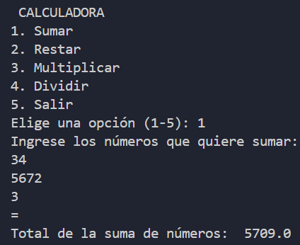
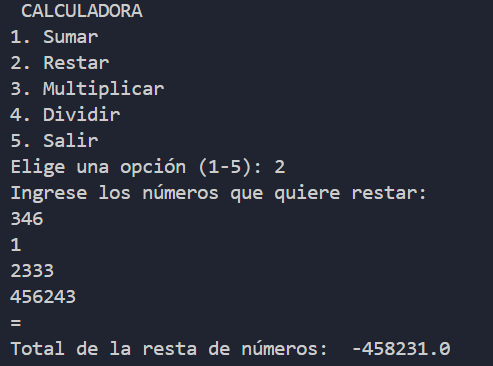
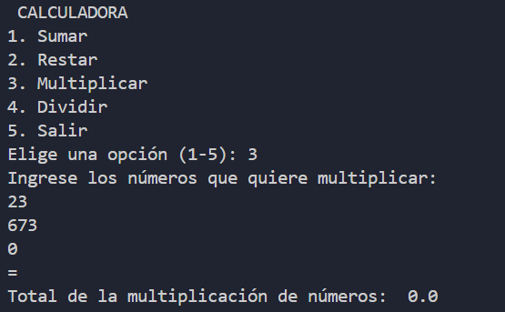
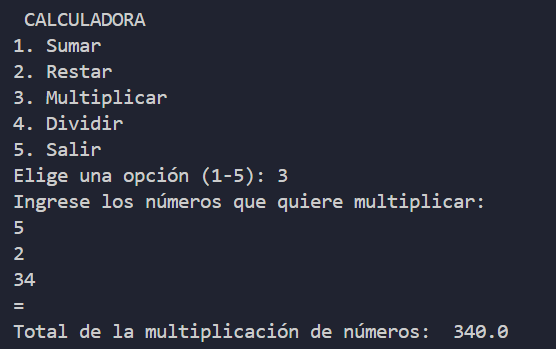
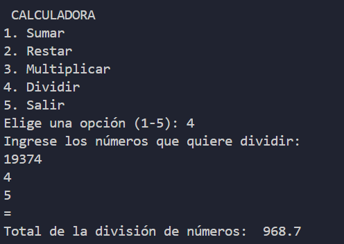
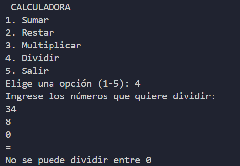

# Calculadora en Python

Calculadora de consola desarrollada en Python para realizar operaciones aritméticas básicas con uno o varios números.

## Funcionalidades

- Suma
- Resta
- Multiplicación
- División
- Validación de los números introducidos
- Aviso cuando se intenta dividir entre cero

## Requisitos

- Python 3.10 o superior

## Uso

1. Abre una terminal en la carpeta del proyecto.
2. Ejecuta el programa:

   ```bash
   python main.py
   ```

3. Elige una operación en el menú.
4. Introduce los números, uno por línea. Escribe `=` o pulsa Enter en una línea vacía para finalizar la entrada y calcular el resultado.
5. Elige la opción `5` para salir.

## Capturas de pantalla

Capturas de pantalla que muestran el funcionamiento de la aplicación

### Captura (Suma):



### Captura (Resta):



### Capturas (Multiplicación):





### Capturas (División):




